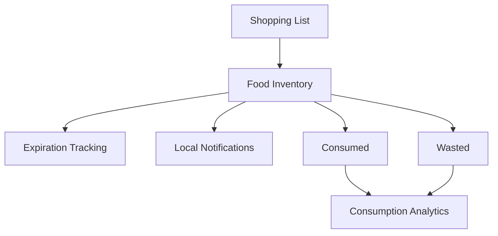
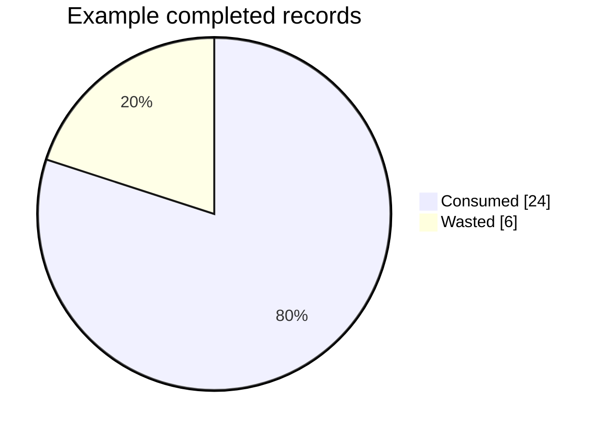

# 🌿 israfEtme

**Smart Food Management & Waste Reduction Application**


## Project Overview

israfEtme is a sustainability-focused mobile application designed to help users reduce household food waste through inventory management, expiration date tracking, local notifications, shopping planning, and consumption analytics.

The application combines mobile software development with data-driven insights to encourage responsible consumption and improve household food management.

> Unutma! Çöpe attığın her ürün birilerinin bulamadığıdır.

## Key Features

- **Inventory Management:** Add, edit, delete, categorize, and track food products.
- **Expiration Date Tracking:** Automatic expiration status calculation and priority sorting.
- **Smart Reminders:** Scheduled local notifications before expiration.
- **Shopping List:** Shopping planning and direct transfer of purchased products to inventory.
- **Consumption History:** Track consumed and wasted products.
- **Waste Analytics:** Category-level statistics and weekly activity summaries.
- **Local Data Persistence:** SQLite-backed key-value storage.
- **Input Validation:** Date, quantity, and stored record validation.

## Application Workflow



## Product Categories

| Category |
|---|
| Dairy Products |
| Fruits & Vegetables |
| Meat & Fish |
| Grains & Legumes |
| Beverages |
| Other |

Supported measurement units: pieces, kg, g, L, and mL.

## Expiration Tracking

| Status | Description |
|---|---|
| Expired | Expiration date has passed. |
| Expiring Soon | Three days or fewer remaining, including today. |
| Normal | More than three days remaining. |

## Notification System

| Reminder | Scheduled local time |
|---|---|
| 3 days before expiration | 09:00 |
| 1 day before expiration | 09:00 |
| Expiration day | 09:00 |

Reminders are scheduled at approximately 09:00 local time. Existing notifications are reconciled when products are edited, removed, or marked as consumed or wasted.

## Data Analytics

The application calculates descriptive statistics from locally recorded consumption and waste events.

| Metric | Description |
|---|---|
| Active inventory | Number of stored product records |
| Consumed products | Completed consumption records |
| Wasted products | Completed waste records |
| Waste rate | Percentage of completed records marked as wasted |
| Category analysis | Waste distribution by product category |
| Weekly activity | Consumption and waste in the previous seven days |

```math
\text{Waste Rate} = \frac{\text{Wasted Records}}{\text{Completed Records}} \times 100
```

Analytics currently use record counts rather than weight, volume, or financial loss. The application reports zero when there are no completed records.

### Example Analytics Dashboard

Illustrative data — not actual user statistics.

| In stock | Consumed | Wasted | Waste rate |
|---:|---:|---:|---:|
| 12 | 24 | 6 | 20% |



## Technical Architecture

| Layer | Technology |
|---|---|
| Mobile framework | React Native |
| Development platform | Expo |
| Programming language | TypeScript |
| Navigation | Expo Router |
| State management | React Hooks |
| Local storage | Expo SQLite KV Store |
| Notifications | Expo Notifications |
| Data analytics | TypeScript-based aggregation |

## Repository Structure

```text
israf-etme/
├── assets/
├── src/
│   ├── app/
│   │   ├── _layout.tsx
│   │   ├── index.tsx
│   │   └── explore.tsx
│   ├── components/
│   │   ├── alisveris-ekrani.tsx
│   │   ├── bildirim-yoneticisi.tsx
│   │   ├── istatistik-ekrani.tsx
│   │   └── karsilama-ekrani.tsx
│   ├── constants/
│   └── hooks/
├── app.json
├── package.json
├── package-lock.json
├── tsconfig.json
├── LICENSE
└── README.md
```

Core application files and directories.

## Installation & Usage

Prerequisites: Node.js, npm, and a compatible Expo development environment.

```bash
git clone https://github.com/blgmstf332/israf-etme.git
cd israf-etme
npm ci
npx expo start
```

Open the application using a compatible Expo Go version or Android development environment.

To start Android:

```bash
npm run android
```

## Project Roadmap

- [x] Food inventory management
- [x] Expiration date tracking
- [x] Product categories and quantities
- [x] Local notification scheduling
- [x] Shopping list integration
- [x] Consumption and waste history
- [x] Category-based analytics
- [x] Weekly statistics
- [x] Persistent local storage
- [ ] Personalized food waste recommendations
- [ ] Quantity-based waste analytics
- [ ] Predictive consumption analysis
- [ ] Barcode scanning
- [ ] Cloud synchronization
- [ ] Automated testing
- [ ] Cross-platform validation

## Limitations & Future Improvements

- Develop personalized, data-driven food waste recommendations.
- Extend record-based analytics to standardized quantities.
- Improve Android notification channel configuration.
- Add automated tests for data validation and persistence.
- Validate behavior across supported mobile platforms.
- Improve application interface and remove unused starter components.

## License

The repository includes an MIT license inherited from the Expo starter project. See [LICENSE](LICENSE).

## Author

**Mustafa Kılıç**

Computer Engineering Student — Artificial Intelligence, Machine Learning & Data Science

[GitHub](https://github.com/blgmstf332)
